# Axphi 项目阅读导览

> 生成日期：2026-06-08  
> 适用范围：当前工作区 `e:\project\AxphiRepos\Axphi` 这一版代码。  
> 目标：读完后能知道这个 WPF/C# 项目“从哪里启动、状态放在哪里、VM 怎么依赖、数据怎么流动、应该按什么顺序读”。

---

## 1. 先给结论：这个项目是什么架构？

Axphi 是一个 **Phigros 风格制谱器**，当前处在重构阶段。它的核心架构可以理解为：

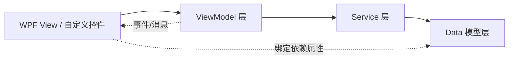

更具体一点：

- `App.xaml.cs` 负责启动和 DI 注册。
- `MainWindow.xaml` 是主界面布局。
- `MainViewModel` 是根 VM，组合所有子 VM。
- `ProjectManager` 是当前工程状态中心，持有 `EditingProject`。
- `Project` / `Chart` / `JudgementLine` / `Note` 是谱面数据模型。
- `TrackLayoutService` 负责轨道头和时间线的纵向布局同步。
- `PlaybackPositionService` 负责播放时间和 tick 的共享同步。
- `ChartRenderer` / `TimelineRenderSurface` / `TrackHeader` 是自绘控件，直接消费 `Chart` 和布局服务。

---

## 2. 推荐阅读顺序

如果你是接手项目，建议不要从 `MainWindow.xaml` 的所有细节开始读。更好的顺序是：

### 第 1 步：读启动和依赖注入

先读：

- `Axphi/App.xaml.cs`
- `Axphi/MainWindow.xaml.cs`

你要搞清楚：

1. 程序从 `App.OnStartup` 启动。
2. `App.Services` 是全局 DI 容器。
3. `MainWindow` 从 DI 取出。
4. `MainWindow.DataContext = MainViewModel`。

### 第 2 步：读根 VM

读：

- `Axphi/ViewModels/MainViewModel.cs`

它告诉你这个软件当前有哪些主要功能区：

- `BezierViewModel`
- `FileActionsViewModel`
- `TrackHeaderViewModel`
- `TimeLineViewModel`
- `ChartDisplayViewModel`
- `ProjectManager`

### 第 3 步：读数据模型

读：

- `Axphi/Data/Project.cs`
- `Axphi/Data/ProjectMetadata.cs`
- `Axphi/Data/Chart.cs`
- `Axphi/Data/JudgementLine.cs`
- `Axphi/Data/Note.cs`
- `Axphi/Data/AnimatableProperties/Property.cs`
- `Axphi/Data/KeyFrames/KeyFrame.cs`

这一层是最重要的，因为 UI 最后都是在编辑这些对象。

### 第 4 步：读 Service

读：

- `Axphi/Services/ProjectManager.cs`
- `Axphi/Services/ProjectStorageService.cs`
- `Axphi/Services/TrackLayoutService.cs`
- `Axphi/Services/PlaybackPositionService.cs`
- `Axphi/Services/AudioPlaybackService.cs`

Service 层负责“跨 VM 共享状态”和“实际业务动作”。

### 第 5 步：读 View 和自绘控件

读：

- `Axphi/MainWindow.xaml`
- `Axphi/Views/ChartDisplay.xaml`
- `Axphi/Views/ChartDisplay.xaml.cs`
- `Axphi/Components/ChartRenderer.cs`
- `Axphi/Components/TimelineRenderSurface.cs`
- `Axphi/Components/TrackHeader.cs`
- `Axphi/Components/TimelineRuler.cs`
- `Axphi/Components/PlayHead.cs`

这一步主要看绑定关系和自绘逻辑。

---

## 3. 项目目录心智地图

```text
Axphi/
├─ App.xaml.cs                 # 启动入口 + DI 注册
├─ MainWindow.xaml             # 主窗口布局
├─ MainWindow.xaml.cs          # 设置 DataContext，窗口生命周期
├─ ViewModels/                 # MVVM 的 VM 层
├─ Services/                   # 业务服务、状态同步、文件、音频、布局
├─ Data/                       # 谱面、工程、Note、判定线、关键帧等纯数据
├─ Components/                 # 自定义控件和自绘控件
├─ Views/                      # 用户控件、对话框
├─ Themes/                     # WPF 样式资源
├─ Utilities/                  # 工具函数、导出器、消息定义
└─ Resources/                  # 图片和音效资源
```

---

## 4. 启动流程

核心文件：`Axphi/App.xaml.cs`

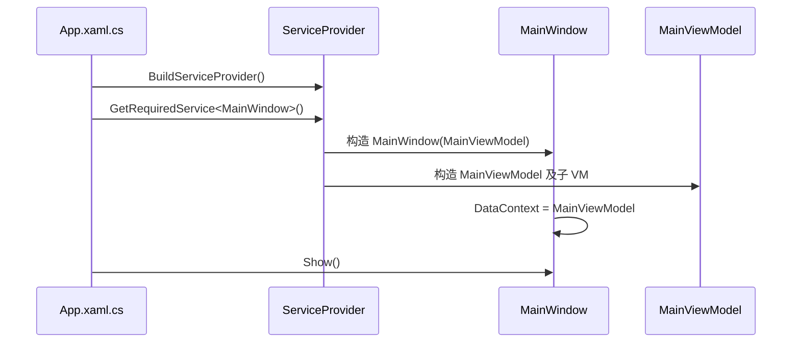

当前 DI 注册大致是：

| 生命周期 | 类型 |
|---|---|
| Singleton | `IMessenger` |
| Singleton | `MainWindow` |
| Singleton | `MainViewModel` |
| Singleton | `BezierViewModel` |
| Singleton | `ChartDisplayViewModel` |
| Singleton | `ProjectManager` |
| Singleton | `IProjectStorageService -> ProjectStorageService` |
| Singleton | `PlaybackPositionService` |
| Singleton | `IFileService -> WindowsFileService` |
| Singleton | `INotificationService -> WindowsNotificationService` |
| Singleton | `IOfficialChartExportDialogService -> OfficialChartExportDialogService` |
| Singleton | `FileActionsViewModel` |
| Singleton | `TrackHeaderViewModel` |
| Singleton | `TimeLineViewModel` |
| Singleton | `TrackLayoutService` |
| Transient | `IAudioPlaybackService -> AudioPlaybackService` |

注意：`ChartDisplayViewModel` 是 Singleton，但它注入的 `IAudioPlaybackService` 是 Transient。也就是说当前这个 VM 生命周期内会拿到一个独立音频服务实例，并在 `Dispose()` 时释放。

---

## 5. ViewModel 依赖、继承、组合关系

### 5.1 总览图

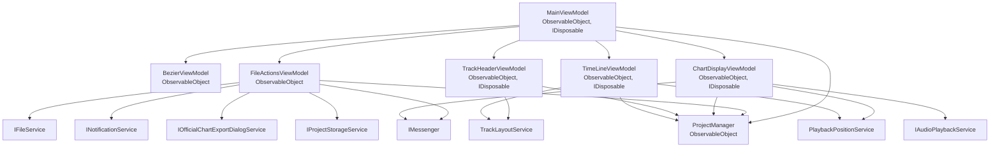

### 5.2 VM 明细表

| VM | 继承/接口 | 主要依赖 | 主要职责 |
|---|---|---|---|
| `MainViewModel` | `ObservableObject`, `IDisposable` | 子 VM、`ProjectManager` | 根 VM，聚合各功能区 VM，提供 demo 加载命令，窗口关闭时释放子 VM |
| `BezierViewModel` | `ObservableObject` | 无 | 贝塞尔曲线编辑工具的四个控制点值 |
| `FileActionsViewModel` | `ObservableObject` | `IFileService`, `ProjectManager`, `IMessenger`, `INotificationService`, `IOfficialChartExportDialogService`, `IProjectStorageService` | 打开/保存工程，导入音频/曲绘，导出官方谱 |
| `ChartDisplayViewModel` | `ObservableObject`, `IDisposable` | `ProjectManager`, `IMessenger`, `IAudioPlaybackService`, `PlaybackPositionService` | 播放/暂停/停止，维护当前时间、当前谱面、曲绘、显示开关，驱动渲染刷新和音频同步 |
| `TimeLineViewModel` | `ObservableObject`, `IDisposable` | `ProjectManager`, `TrackLayoutService`, `PlaybackPositionService` | 时间线视口、缩放、当前 tick、游标 X、布局版本、当前 Chart |
| `TrackHeaderViewModel` | `ObservableObject`, `IDisposable` | `ProjectManager`, `TrackLayoutService` | 左侧轨道头的当前 Chart、纵向视口、展开状态、布局版本 |

### 5.3 关键观察

这个项目当前的 VM 关系比较清晰：

- `MainViewModel` 是组合根，不直接做大量业务。
- 文件类操作集中在 `FileActionsViewModel`。
- 播放和渲染状态集中在 `ChartDisplayViewModel`。
- 时间线和轨道头不各自计算布局，而是共享 `TrackLayoutService`。
- 当前工程数据统一从 `ProjectManager.EditingProject` 读取。

---

## 6. Data 模型关系

### 6.1 核心模型图

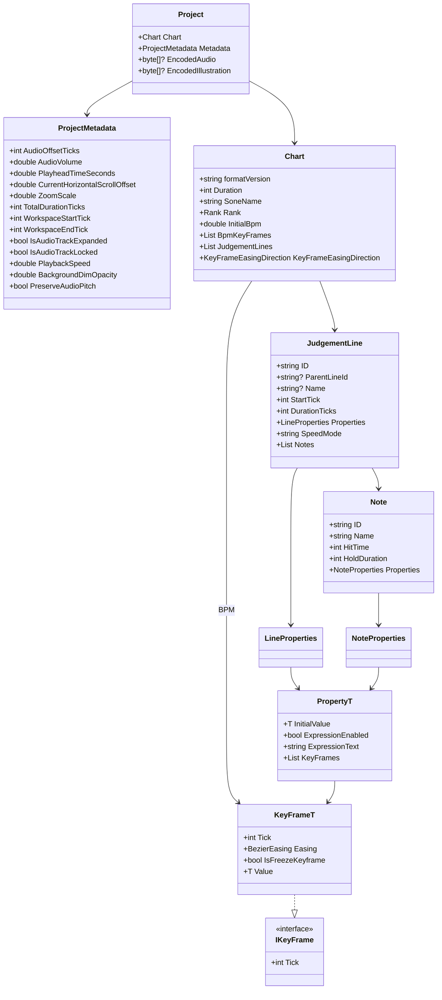

### 6.2 数据层怎么理解

可以把数据层理解成三层：

```text
Project 工程
└─ Chart 谱面
   ├─ BpmKeyFrames
   └─ JudgementLines 判定线列表
      ├─ LineProperties 判定线动画属性
      └─ Notes 音符列表
         └─ NoteProperties 音符动画属性
```

### 6.3 关键帧模型

`Property<T>` 表示一个“可动画属性”。例如：

- 判定线位置：`JudgementLine.Properties.Position`
- 判定线缩放：`JudgementLine.Properties.Scale`
- 判定线旋转：`JudgementLine.Properties.Rotation`
- Note 类型：`Note.Properties.Kind`
- Note 位置：`Note.Properties.Position`

每个属性都有：

- `InitialValue`：初始值。
- `ExpressionEnabled`：是否启用表达式。
- `ExpressionText`：表达式文本。
- `KeyFrames`：真正的关键帧列表。

`KeyFrame<T>` 实现了非泛型接口 `IKeyFrame`，这样时间线 UI 可以不关心值类型，只要拿到 `Tick` 就能绘制和拖拽关键帧。

---

## 7. Service 层职责

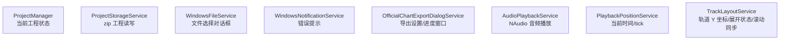

| Service | 接口 | 职责 |
|---|---|---|
| `ProjectManager` | 无接口 | 当前工程会话状态，持有 `EditingProject` 和 `EditingProjectFilePath` |
| `ProjectStorageService` | `IProjectStorageService` | 把工程保存为 zip，读写 `chart.json`、`metadata.json`、`audio`、`illustration` |
| `WindowsFileService` | `IFileService` | 打开/保存文件对话框 |
| `WindowsNotificationService` | `INotificationService` | 错误通知 |
| `OfficialChartExportDialogService` | `IOfficialChartExportDialogService` | 官方谱导出设置和进度窗口 |
| `AudioPlaybackService` | `IAudioPlaybackService` | 读取音频、解码临时 WAV、用 `WasapiOut` 播放/暂停/定位 |
| `PlaybackPositionService` | 无接口 | 跨组件共享 `CurrentTime` 和 `CurrentTick` |
| `TrackLayoutService` | `ITrackLayoutProvider` | 判定线/属性行 Y 坐标、展开状态、内容高度、左右滚动同步 |

---

## 8. View 与绑定关系

### 8.1 主窗口绑定关系

`MainWindow.xaml.cs`：

```text
MainWindow.DataContext = MainViewModel
```

因此 `MainWindow.xaml` 里面默认都能绑定 `MainViewModel` 的属性。

主要区域：

| UI 区域 | XAML 位置 | DataContext / Binding |
|---|---|---|
| 标题栏 | `Views/TitleBar.xaml` | 继承 `MainViewModel` |
| 贝塞尔工具 | `MainWindow.xaml` 左上 | `BezierViewModel.X1/Y1/X2/Y2` |
| Display Controls | `MainWindow.xaml` 右上 | 通过 `ElementName=MainChartDisplay` 绑定 `ChartDisplayViewModel` |
| 渲染窗口 | `Views/ChartDisplay.xaml` | `ChartDisplayViewModel` |
| 左侧轨道头 | `Components/TrackHeader` | `TrackHeaderViewModel` |
| 右侧时间线 | `Components/TimelineRenderSurface` | `TimeLineViewModel` |
| 时间标尺 | `Components/TimelineRuler` | `TimeLineViewModel` |
| 播放游标 | `Components/Playhead` | `TimeLineViewModel` |
| Project 面板 | `MainWindow.xaml` 右下 | `FileActionsViewModel` 的命令 |

### 8.2 ChartDisplay 绑定链

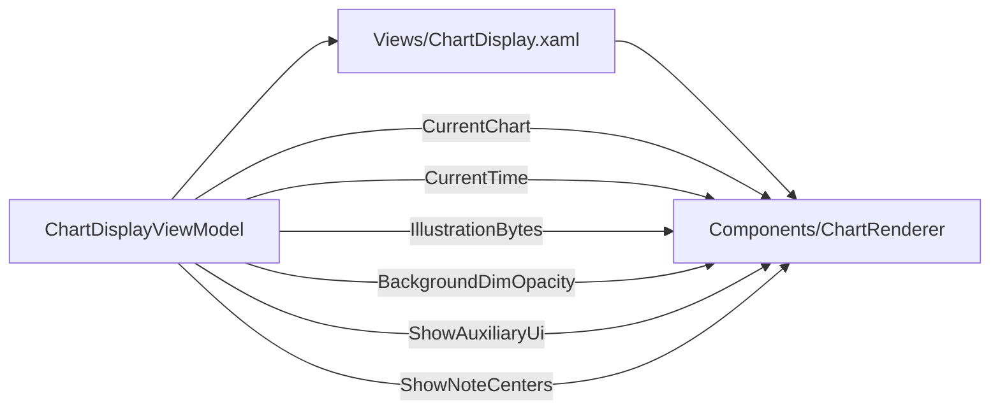

`ChartDisplay.xaml.cs` 本身很薄：

- 监听 VM 的 `RenderInvalidated` 事件。
- 调用 `InternalChartRenderer.InvalidateVisual()`。
- 监听 `UserNotificationRequested` 并弹出提示。

也就是说，真正的渲染在 `ChartRenderer.OnRender()`，不是在 View code-behind。

### 8.3 时间线绑定链

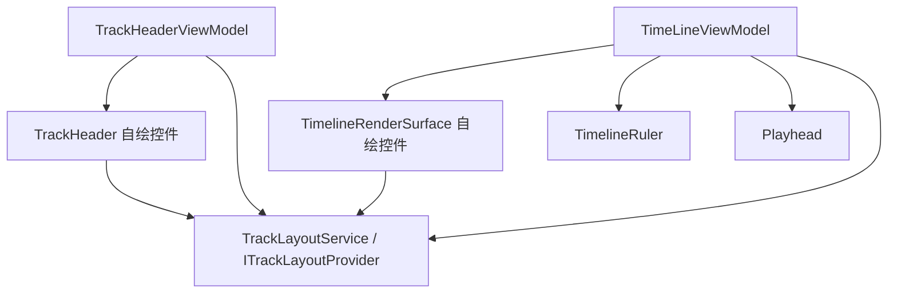

左侧 `TrackHeader` 和右侧 `TimelineRenderSurface` 共用同一个 `TrackLayoutService`，所以它们的 Y 坐标能对齐。

---

## 9. 关键数据流

### 9.1 打开工程

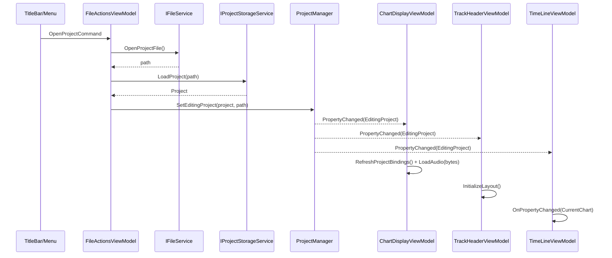

重点：打开工程后，不是手动挨个刷新 UI，而是通过 `ProjectManager.EditingProject` 的 `PropertyChanged` 让各 VM 自己响应。

### 9.2 保存工程

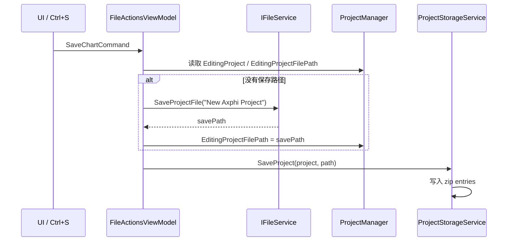

`ProjectStorageService` 保存的 zip 条目：

- `chart.json`
- `metadata.json`
- `audio`
- `illustration`

### 9.3 导入音频

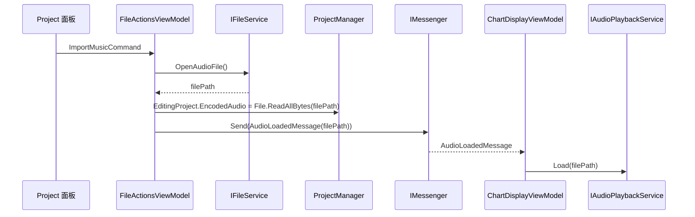

注意：

- 导入时，内存工程存的是 `EncodedAudio` 字节。
- 立即播放加载时，当前用的是文件路径消息 `AudioLoadedMessage(filePath)`。
- 重新打开工程时，`ChartDisplayViewModel` 会从 `EncodedAudio` 字节加载音频。

### 9.4 导入曲绘

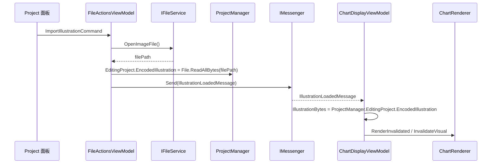

### 9.5 播放进度和游标同步

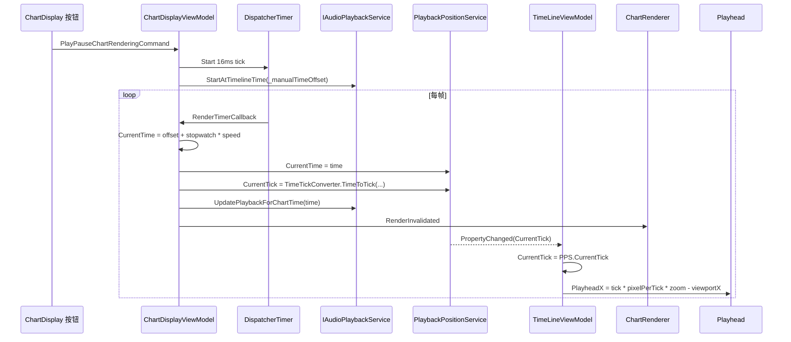

这个项目的播放同步中心不是 `ChartRenderer`，而是：

```text
ChartDisplayViewModel -> PlaybackPositionService -> TimeLineViewModel
```

`ChartRenderer` 只负责根据绑定到的 `CurrentTime` 自绘画面。

### 9.6 谱面画面渲染

`ChartRenderer.OnRender()` 的核心逻辑：

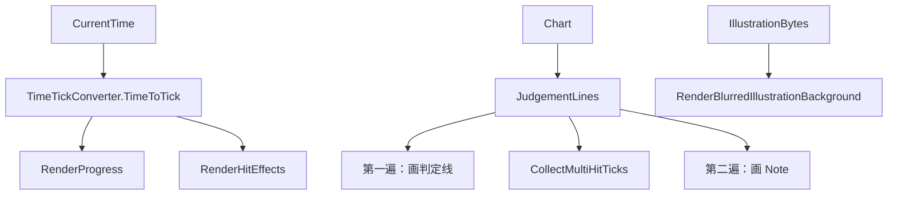

关键点：

- `TimeSpan Time` 会被转换成精确 `double currentTick`。
- 判定线和 Note 分两遍画，保证层级正确。
- 曲绘背景会缓存模糊结果。
- 辅助 UI 由 `ShowAuxiliaryUi` 和 `ShowNoteCenters` 控制。

### 9.7 时间线和轨道头布局同步

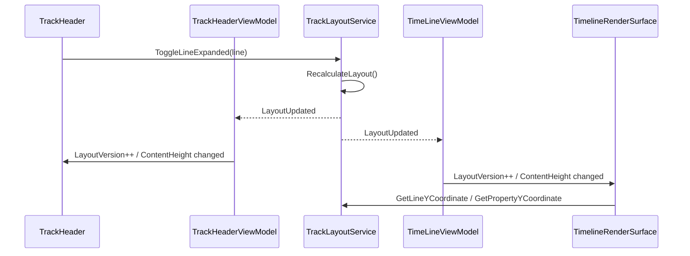

左右两侧滚动同步：

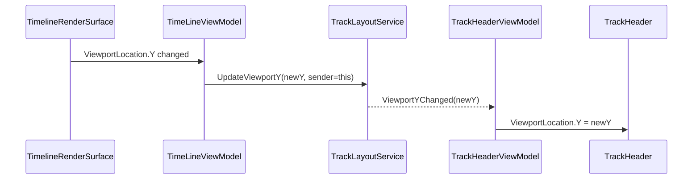

重点：

- Y 轴滚动共享 `TrackLayoutService.ViewportY`。
- `sender` 用来避免自己收到自己发出的广播后产生循环更新。
- `LayoutVersion` 是一个“强制自绘控件重绘”的版本号。

### 9.8 时间线关键帧编辑

`TimelineRenderSurface` 不再依赖一堆 VM item，而是直接基于数据模型自绘：

```text
Chart -> JudgementLines -> LineProperties -> Property<T>.KeyFrames
```

它内部用：

- `_selectedKeyFrames: HashSet<IKeyFrame>` 保存选中关键帧。
- `_hoveredKeyFrame` 保存 hover 状态。
- `_draggingKeyFrame` 保存拖拽状态。

拖拽时直接修改：

```text
IKeyFrame.Tick
```

也就是说，右侧时间线当前的关键帧交互是“直接写数据模型”。

---

## 10. 消息总线

消息定义在：`Axphi/Utilities/AppMessages.cs`

当前定义：

| 消息 | 作用 |
|---|---|
| `AudioLoadedMessage(string FilePath)` | 导入音频后通知播放 VM 加载音频 |
| `IllustrationLoadedMessage()` | 导入曲绘后通知渲染 VM 刷新曲绘 |
| `UpdateRendererMessage()` | 请求渲染刷新 |
| `JudgementLinesChangedMessage()` | 判定线变更通知，目前当前代码里较少使用 |
| `ForcePausePlaybackMessage()` | 强制暂停播放，目前当前代码里较少使用 |
| `ForceSeekMessage(double TargetSeconds)` | 强制 seek，目前当前代码里较少使用 |

当前实际明显使用链路：

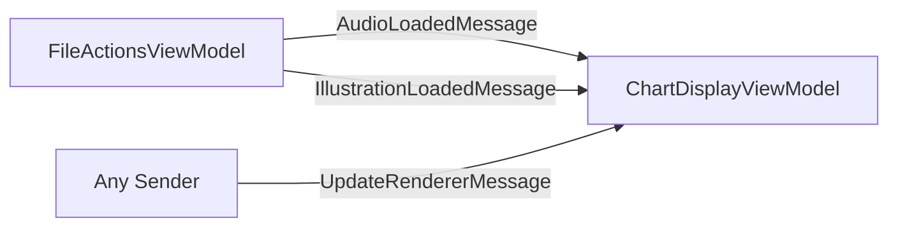

注意：消息总线不是所有同步的核心。打开工程、时间线播放、布局同步主要靠：

- `ProjectManager.PropertyChanged`
- `PlaybackPositionService.PropertyChanged`
- `TrackLayoutService.ViewportYChanged / LayoutUpdated`

---

## 11. 文件操作数据流

### 11.1 工程文件格式

当前 `.axp` 工程本质是 zip：

```text
project.axp
├─ chart.json
├─ metadata.json
├─ audio
└─ illustration
```

保存逻辑在 `ProjectStorageService.SaveProject()`。

读取逻辑在 `ProjectStorageService.LoadProject()`。

### 11.2 JSON 序列化注意点

`ProjectStorageService` 使用：

```text
JsonSerializerOptions
├─ IncludeFields = true
└─ PreferredObjectCreationHandling = Populate
```

这很重要，因为模型里有不少只读集合/只读属性，例如：

- `JudgementLine.Properties { get; }`
- `Note.Properties { get; }`
- `Property<T>.KeyFrames { get; }`

如果没有 `Populate`，反序列化时这类对象容易丢数据。

---

## 12. 读 `MainWindow.xaml` 时怎么不迷路

`MainWindow.xaml` 内容多，但它其实分成 5 块：

```text
┌──────────────┬────────────────────────┬──────────────┐
│ Flow         │ ChartDisplay           │ Display Ctrl │
│ 贝塞尔工具   │ 谱面播放/渲染窗口       │ 渲染设置      │
├──────────────┴────────────────────────┴──────────────┤
│ TrackHeader + Timeline                 │ Project     │
│ 左下时间线区域                         │ 工程操作     │
└────────────────────────────────────────┴──────────────┘
```

阅读技巧：

1. 先看每个区域绑定哪个 VM。
2. 再看命令绑定，例如 `FileActions.SaveChartCommand`。
3. 最后再看样式和布局细节。

不要一开始就逐行读样式、Splitter、Margin，那些不是业务核心。

---

## 13. 如果要改功能，先判断改哪一层

### 13.1 改“工程数据结构”

优先看：

- `Data/`
- `ProjectStorageService`
- `ChartRenderer`
- `TimelineRenderSurface`

例如新增一个判定线属性，不能只改 `LineProperties`，还要考虑：

- 是否需要序列化。
- 是否要在时间线绘制关键帧。
- 是否要在渲染器里生效。
- 是否要在导出器里生效。

### 13.2 改“文件菜单/导入导出”

看：

- `FileActionsViewModel`
- `IFileService` / `WindowsFileService`
- `ProjectStorageService`
- `OfficialChartExporter`
- `OfficialChartExportDialogService`

### 13.3 改“播放/暂停/时间同步”

看：

- `ChartDisplayViewModel`
- `AudioPlaybackService`
- `PlaybackPositionService`
- `TimeLineViewModel`
- `ChartRenderer`

### 13.4 改“时间线显示和关键帧拖拽”

看：

- `TimeLineViewModel`
- `TimelineRenderSurface`
- `TrackLayoutService`
- `TrackHeaderViewModel`
- `TrackHeader`

### 13.5 改“左侧轨道头展开/折叠”

看：

- `TrackHeader`
- `TrackHeaderViewModel`
- `TrackLayoutService`

---

## 14. 当前项目里的几个重要设计取舍

### 14.1 自绘控件越来越多

当前代码里：

- `ChartRenderer` 自绘谱面预览。
- `TimelineRenderSurface` 自绘右侧时间线。
- `TrackHeader` 自绘左侧轨道头。
- `TimelineRuler` 自绘时间标尺。

这说明项目正在从“模板/控件树驱动”转向“数据级虚拟化 + 自绘”。

优点：

- 大谱面性能更好。
- 不需要为每个关键帧创建一个 WPF 控件。

代价：

- 命中测试、选择、拖拽要自己写。
- 状态同步更依赖服务和 DP 绑定。

### 14.2 `ProjectManager` 是事实源

多数 VM 不保存自己的完整谱面副本，而是从：

```text
ProjectManager.EditingProject.Chart
```

读取当前数据。

所以读代码时遇到 `CurrentChart`，一般都要回到 `ProjectManager`。

### 14.3 布局和滚动交给 `TrackLayoutService`

时间线左右两边要严格对齐，所以不能各自算 Y 坐标。

统一入口是：

- `GetLineYCoordinate(line)`
- `GetPropertyYCoordinate(line, propertyName)`
- `GetActiveProperties(line)`
- `ContentHeight`
- `ViewportYChanged`

### 14.4 播放时间和时间线游标解耦

`ChartDisplayViewModel` 负责推进时间。

`TimeLineViewModel` 不自己计时，只监听 `PlaybackPositionService.CurrentTick`，然后更新 `PlayheadX`。

---

## 15. 快速定位表

| 想知道什么 | 优先看哪个文件 |
|---|---|
| 程序怎么启动 | `App.xaml.cs` |
| DI 注册了什么 | `App.xaml.cs` |
| 主窗口绑定谁 | `MainWindow.xaml.cs` |
| 主界面有哪几块 | `MainWindow.xaml` |
| 根 VM 组合关系 | `ViewModels/MainViewModel.cs` |
| 当前工程存在哪里 | `Services/ProjectManager.cs` |
| 工程怎么保存/打开 | `Services/ProjectStorageService.cs`、`ViewModels/FileActionsViewModel.cs` |
| 音频怎么导入/播放 | `FileActionsViewModel.cs`、`ChartDisplayViewModel.cs`、`AudioPlaybackService.cs` |
| 曲绘怎么显示 | `FileActionsViewModel.cs`、`ChartDisplayViewModel.cs`、`ChartRenderer.cs` |
| 谱面怎么渲染 | `Components/ChartRenderer.cs` |
| 时间怎么转 tick | `Utilities/TimeTickConverter.cs` |
| 时间线怎么画 | `Components/TimelineRenderSurface.cs` |
| 左侧轨道头怎么画 | `Components/TrackHeader.cs` |
| 左右时间线怎么对齐 | `Services/TrackLayoutService.cs` |
| 播放游标怎么同步 | `Services/PlaybackPositionService.cs`、`ViewModels/TimeLineViewModel.cs` |
| 消息有哪些 | `Utilities/AppMessages.cs` |
| 官方谱怎么导出 | `Utilities/OfficialChartExporter.cs` |

---

## 16. 最小心智模型

如果只记一个模型，记这个：

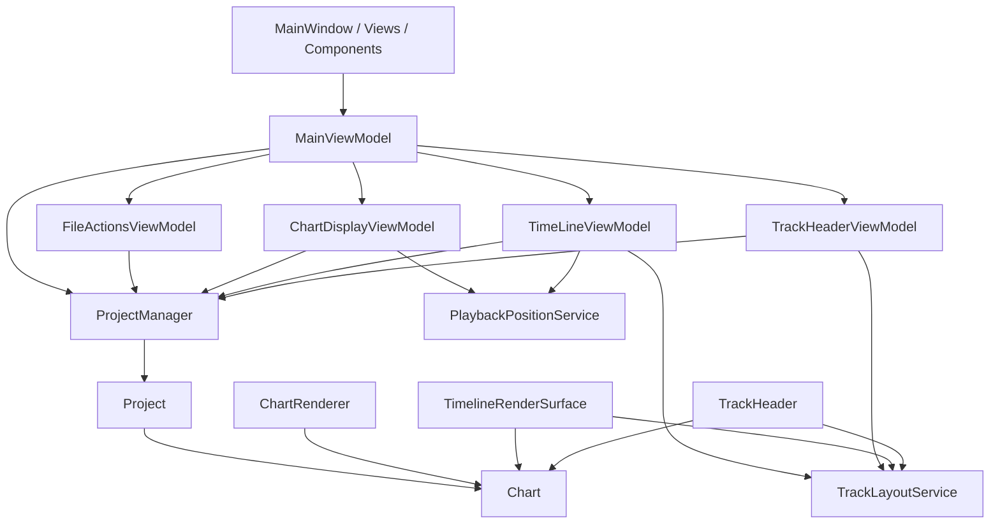

一句话概括：

> UI 绑定 VM，VM 通过 Service 读写当前 `Project`，自绘控件直接消费 `Chart` 和布局服务，播放状态通过 `PlaybackPositionService` 同步。

---

## 17. 继续深入时的建议

如果你要继续读项目，推荐按这三个专题拆开：

1. **工程读写专题**  
   `FileActionsViewModel` -> `ProjectStorageService` -> `Data/*`

2. **播放渲染专题**  
   `ChartDisplayViewModel` -> `PlaybackPositionService` -> `ChartRenderer` -> `TimeTickConverter`

3. **时间线编辑专题**  
   `TimeLineViewModel` -> `TimelineRenderSurface` -> `TrackLayoutService` -> `TrackHeader`

不要同时读所有文件。每次只追一个数据流，项目就会容易很多。
